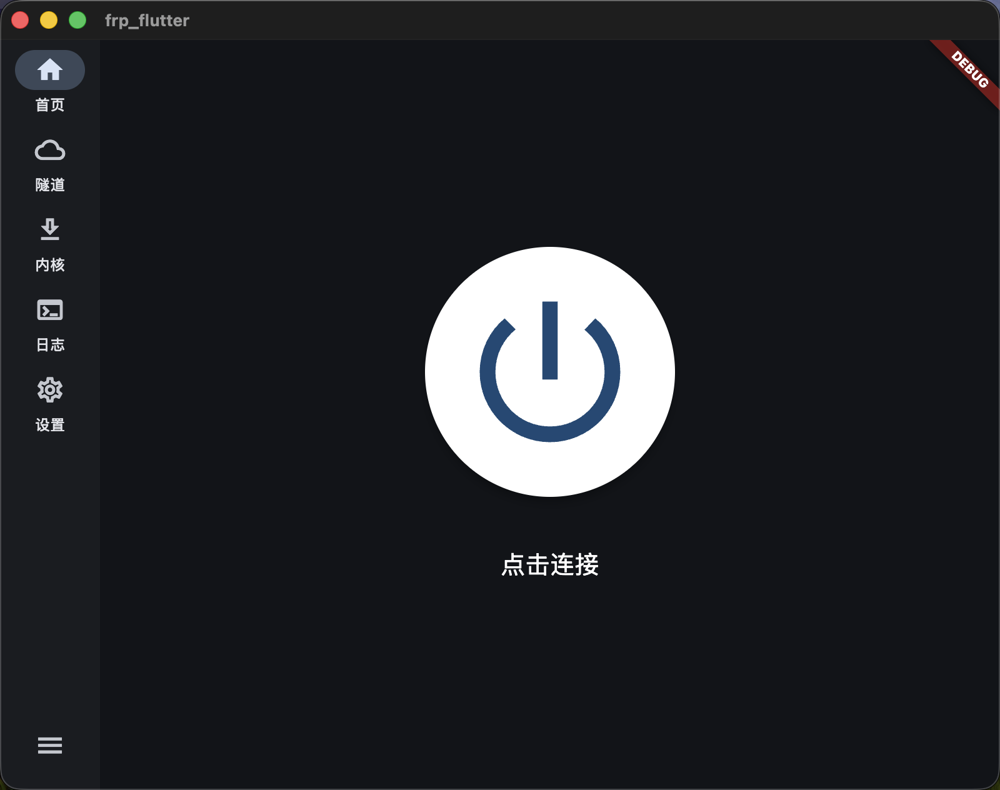
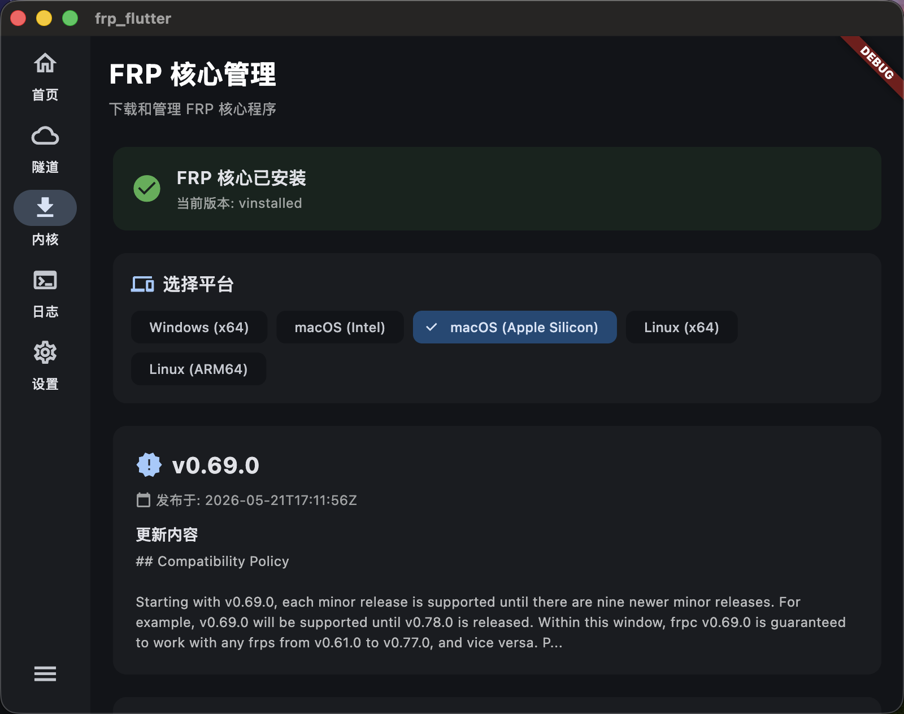
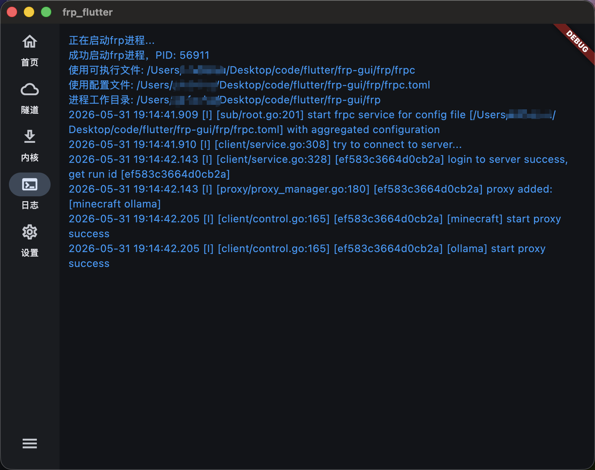

# frp-gui

A cross-platform desktop FRP (Fast Reverse Proxy) GUI management client built with Flutter, supporting Windows, macOS, and Linux.

> [中文文档](./README_zh.md) | [Build Guide](./BUILD.md)

---

## Architecture

```
+----------------------------------------------------------+
|                    UI Layer (Flutter)                    |
|  +--------+--------+----------+----------+------------+  |
|  | OOBE   |  Home  | Tunnels  | Download |    Logs    |  |
|  | Setup  | Start/ |   CRUD   |  Isolate |  Real-time |  |
|  | Wizard | Stop   |  Config  |  Stream  |   Output   |  |
|  +--------+--------+----------+----------+------------+  |
|  |       Settings: Appearance / Server / Autostart       |  |
|  +-------------------------------------------------------+  |
|  |   Controllers (Theme / TunnelList / ConnectionTimer)  |  |
|  +-------------------------------------------------------+  |
|  |  FrpProcessService  KernelDownloadService  ConfigRepo |  |
|  |  (Subprocess/PID)   (Isolate DL/Extract)   (TOML IO)  |  |
|  +-------------------------------------------------------+  |
|  |                  FRP Binary (frpc)                    |  |
|  |            External subprocess, stdout/stderr         |  |
|  +-------------------------------------------------------+  |
+----------------------------------------------------------+
```

---

## Screenshots

### macOS — Main Interface



### macOS — Core Download



### macOS — Log Viewer



---

## Features

| Module | Description |
|--------|-------------|
| **OOBE Wizard** | First-launch setup wizard for FRP server address, port, and token (with skip support) |
| **Home** | One-click start/stop FRP daemon with live connection duration timer and exit probe |
| **Tunnels** | Visual CRUD for multi-protocol proxy configs (`tcp`, `udp`, `http`, `https`, `stcp`, `xtcp`, `sudp`) |
| **Core Download** | Fetch latest FRP binaries from GitHub Releases in a background `Isolate` with mirror acceleration |
| **Logs** | Real-time scrollable FRP process output with ANSI escape sanitization and one-click clear |
| **Appearance** | Light/Dark/System theme mode + custom Material 3 seed accent colors |
| **Server Config** | Configure FRP server address, port, and authentication token while preserving custom TOML sections |
| **Autostart** | Desktop login autostart across Windows (`HKCU\Run`), macOS (`LaunchAgents`), and Linux (`XDG Autostart`) |

---

## Supported Platforms

| Platform | Status | Package Format |
|----------|--------|----------------|
| Windows (x64 / ARM64) | Supported | `.exe` |
| macOS (Intel + Apple Silicon) | Supported | `.app` / `.dmg` |
| Linux (x64 + ARM64) | Supported | Executable bundle |

---

## Project Structure

```
frp-gui/
├── lib/
│   ├── main.dart                    # App entry, desktop window lifecycle, OOBE & --autostart
│   ├── app.dart                     # MaterialApp, theme binding, route table
│   ├── models/                      # Strongly-typed domain models (ServerConfig, TunnelConfig, etc.)
│   ├── services/                    # TOML repository, frpc subprocess, Isolate downloader, autostart
│   ├── controllers/                 # ChangeNotifier state coordinators
│   └── ui/
│       ├── shell/                   # Adaptive MainShellPage & custom DesktopTitleBar
│       ├── pages/                   # Feature screens (home, tunnels, download, logs, settings, oobe)
│       ├── widgets/                 # Shared responsive modals, fields, setting cards
│       └── utils/                   # Floating capsule toast helper
├── test/                            # Storage, downloader Isolate, and widget smoke tests
├── frp/
│   └── frpc.example.toml            # Desensitized main config template (runtime binaries ignored)
├── image/                           # Screenshots
├── macos/                           # macOS runner
├── linux/                           # Linux runner
└── windows/                         # Windows runner
```

---

## Quick Start

```bash
# 1. Clone the repository
git clone https://github.com/xiefuzhu/frp-gui.git
cd frp-gui

# 2. Install dependencies
flutter pub get

# 3. Run static analysis and tests
flutter analyze
flutter test

# 4. Launch on current desktop platform
flutter run -d windows   # or macos / linux
```

See [BUILD.md](./BUILD.md) for release packaging instructions.

---

## License

This project downloads FRP client binaries from [fatedier/frp](https://github.com/fatedier/frp), distributed under the Apache 2.0 License.
