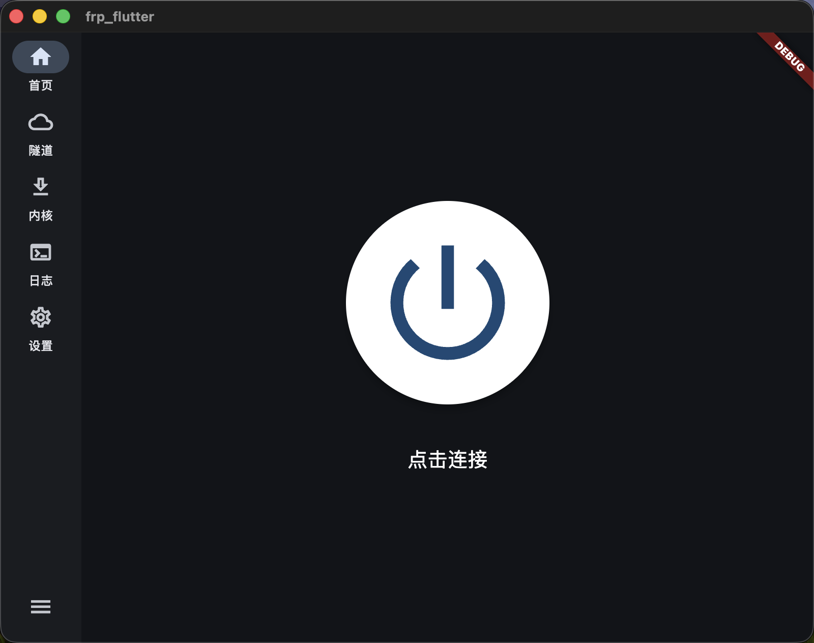
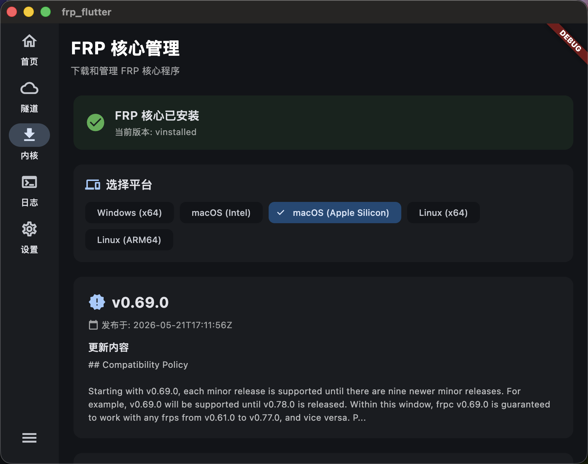
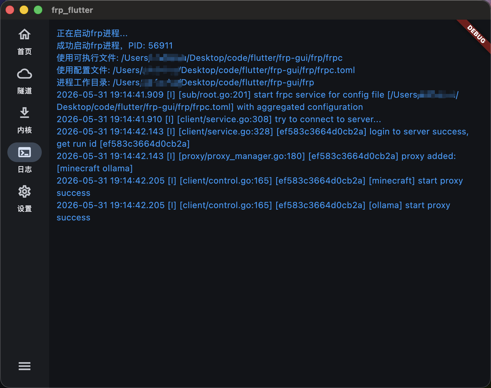

# frp-gui

基于 Flutter 构建的跨平台桌面端 FRP（内网穿透）图形化管理客户端，支持 Windows、macOS 与 Linux。

> [English](./README.md) | [构建指南](./BUILD.md)

---

## 软件架构

```
+----------------------------------------------------------+
|                       UI 层 (Flutter)                     |
|  +--------+----------+----------+--------+------------+  |
|  | OOBE   |   首页   | 隧道管理 | 内核页 |    日志    |  |
|  | 引导页 | 启停计时 | 多协议   | 镜像源 |  实时输出  |  |
|  +--------+----------+----------+--------+------------+  |
|  |             设置页 · 外观 / 服务端 / 开机自启          |  |
|  +-------------------------------------------------------+  |
|  |     控制器层 (ThemeController / TunnelList / Timer)    |  |
|  +-------------------------------------------------------+  |
|  |  FrpProcessService  KernelDownloadService  ConfigRepo |  |
|  |  (进程探活/孤儿清理)  (Isolate 流式下载解压)  (TOML)    |  |
|  +-------------------------------------------------------+  |
|  |                  FRP 客户端内核 (frpc)                 |  |
|  |              外部子进程，stdout/stderr 捕获            |  |
|  +-------------------------------------------------------+  |
+----------------------------------------------------------+
```

---

## 界面预览

### macOS — 主界面



### macOS — 内核下载



### macOS — 日志查看



---

## 功能特性

| 模块 | 说明 |
|------|------|
| **OOBE 首次引导** | 首次启动引导配置 FRP 服务器地址、端口与 Token，也支持跳过先下载内核 |
| **首页控制** | 一键启动/停止 `frpc` 守护进程，内置秒退探活、孤儿进程安全清理与连接计时 |
| **多协议隧道** | 可视化管理 `tcp`、`udp`、`http`、`https`、`stcp`、`xtcp`、`sudp` 隧道，单隧道独立 `.toml`/`.bak` 切换并保留自定义扩展字段 |
| **内核在线管理** | 后台 `Isolate` 流式拉取 GitHub Releases 对应架构内核，支持镜像加速、自动回退、热替换与中途取消 |
| **实时日志** | 自动过滤 ANSI 控制字符，跟随滚动展示子进程输出，支持一键清空 |
| **外观定制** | 支持跟随系统/浅色/深色模式及系统强调色、多款 Material 3 主题色持久化 |
| **服务端配置** | 修改服务端地址、端口与鉴权令牌，保存后自动平滑重启运行中的穿透连接且保留自定义配置段 |
| **开机自启动** | 覆盖 Windows 注册表 `HKCU\Run`、macOS `LaunchAgents` 与 Linux `XDG Autostart` |

---

## 支持平台

| 平台 | 状态 | 产物形态 |
|------|------|----------|
| Windows (x64 / ARM64) | 已支持 | `.exe` |
| macOS (Intel + Apple Silicon) | 已支持 | `.app` / `.dmg` |
| Linux (x64 + ARM64) | 已支持 | 可执行文件目录 |

---

## 目录结构

```
frp-gui/
├── lib/
│   ├── main.dart                    # 应用入口、桌面窗口关闭拦截、OOBE 与 --autostart
│   ├── app.dart                     # MaterialApp 主题与路由注册
│   ├── models/                      # 强类型领域模型（ServerConfig、TunnelConfig 等）
│   ├── services/                    # TOML 配置仓储、进程生命周期、Isolate 下载、自启动服务
│   ├── controllers/                 # ChangeNotifier 状态协调器
│   └── ui/
│       ├── shell/                   # 宽窄屏自适应导航外壳与自定义桌面标题栏
│       ├── pages/                   # 业务页面（home / tunnels / download / logs / settings / oobe）
│       ├── widgets/                 # 响应式弹窗、输入组件与设置卡片
│       └── utils/                   # 胶囊浮动提示工具
├── test/                            # 存储、后台 Isolate 下载与界面导航回归测试
├── frp/
│   └── frpc.example.toml            # 脱敏主配置示例模板（运行期二进制与私有配置已忽略）
├── image/                           # 界面截图
├── macos/                           # macOS 原生工程
├── linux/                           # Linux 原生工程
└── windows/                         # Windows 原生工程
```

---

## 快速开始

```bash
# 1. 克隆仓库
git clone https://github.com/xiefuzhu/frp-gui.git
cd frp-gui

# 2. 安装依赖
flutter pub get

# 3. 静态检查与回归测试
flutter analyze
flutter test

# 4. 启动桌面客户端
flutter run -d windows   # 或 macos / linux
```

各平台打包说明请参见 [BUILD.md](./BUILD.md)。

---

## 开源许可

客户端在线下载的 FRP 内核来自 [fatedier/frp](https://github.com/fatedier/frp)，遵循 Apache 2.0 许可证。
